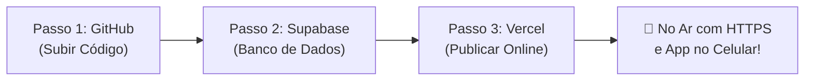

# 🚀 Como Deixar o Axé Agenda Online (Guia Passo a Passo)

Este guia prático mostra como colocar o **Axé Agenda** 100% online, com banco de dados em tempo real, certificado HTTPS e aplicativo instalável no celular do **Pai de Santo Leandro** e da sua esposa.

> 💰 **Custo Zero:** A stack foi desenhada para rodar 100% no tier gratuito da **Vercel** e do **Supabase**, suportando milhares de agendamentos mensais sem nenhum custo.

---

## 📋 Resumo dos 3 Passos



---

## Passo 1: Subir o Código para o GitHub (2 minutos)

O repositório local já está configurado para o seu usuário `NandoCardoso`.

1. Abra o navegador e acesse: **[github.com/new](https://github.com/new)**
2. Preencha apenas o nome do repositório:
   - **Repository name:** `axe-agenda`
   - **Visibilidade:** Escolha *Public* ou *Private* (sua preferência)
   - ⚠️ **Importante:** Deixe **desmarcada** a opção *"Add a README file"* (o projeto já tem commits locais prontos).
3. Clique em **"Create repository"**.
4. No terminal do seu projeto (`d:\PROJECTS\axe-agenda`), execute:
   ```bash
   git add .
   git commit -m "feat: preparar script de deploy e schema unificado"
   git push -u origin main
   ```

*(Se o terminal pedir autorização do GitHub, faça o login rápido pelo navegador).*

---

## Passo 2: Criar o Banco de Dados no Supabase (3 minutos)

1. Acesse **[supabase.com](https://supabase.com)** e faça login (pode usar sua conta do GitHub).
2. Clique em **"New Project"** e preencha:
   - **Name:** `axe-agenda`
   - **Database Password:** Escolha uma senha segura e anote.
   - **Region:** Selecione **South America (São Paulo)** para máxima velocidade.
   - **Pricing Plan:** Free Tier.
   - Clique em **"Create new project"** e aguarde cerca de 1 minuto até o banco inicializar.

### 2.1 Criar as Tabelas e Dados Iniciais (1 Clique)
Preparamos um arquivo único contendo toda a estrutura de tabelas, regras de segurança e dados iniciais das giras:

1. No menu lateral esquerdo do Supabase, clique no ícone **SQL Editor** (ou acesse a aba do editor de SQL).
2. Clique em **"New query"**.
3. Abra o arquivo [supabase/schema_completo.sql](file:///D:/PROJECTS/axe-agenda/supabase/schema_completo.sql), copie todo o seu conteúdo e cole no editor do Supabase.
4. Clique no botão **"Run"** (no canto inferior direito do editor).
5. Você verá a mensagem: *"Success. No rows returned."* — Todas as tabelas (`eventos`, `solicitacoes`, `tipos_gira`, `regras_disponibilidade`), políticas de segurança e a lista de giras já estão criadas!

### 2.2 Copiar as Chaves de Acesso
No menu lateral esquerdo:
1. Vá em **Project Settings** (ícone de engrenagem) ➔ **API** (ou **Data API**).
2. Copie os 3 valores abaixo e guarde em um bloco de notas:
   - **Project URL:** Ex: `https://abcdefghijk.supabase.co`
   - **Project API Keys ➔ `anon` `public`:** Chave pública do cliente.
   - **Project API Keys ➔ `service_role` `secret`:** Chave privada do servidor (clique em *Reveal* para copiar).

---

## Passo 3: Publicar na Vercel (2 minutos)

1. Acesse **[vercel.com](https://vercel.com)** e entre com a sua conta do GitHub.
2. No painel principal, clique em **"Add New..." ➔ "Project"**.
3. Localize o repositório `axe-agenda` e clique em **"Import"**.
4. Na tela de configuração de Deploy, abra a seção **Environment Variables** e adicione as 3 variáveis que você copiou do Supabase:

| Nome da Variável | Valor Copiado do Supabase |
|---|---|
| `NEXT_PUBLIC_SUPABASE_URL` | Sua URL (ex: `https://xxxx.supabase.co`) |
| `NEXT_PUBLIC_SUPABASE_ANON_KEY` | Sua chave `anon` `public` |
| `SUPABASE_SERVICE_ROLE_KEY` | Sua chave `service_role` `secret` |

5. Clique no botão azul **"Deploy"**.
6. Aguarde cerca de 60 segundos. A Vercel irá compilar a aplicação e soltar os confetes de sucesso! 🎉

---

## 📱 Links de Uso e Como Instalar no Celular

Ao concluir o deploy, a Vercel gerará seu link público (exemplo: `https://axe-agenda.vercel.app`).

### 1. Link Público dos Consulentes
Envie este link no WhatsApp do terreiro ou coloque na biografia do Instagram:
> `https://axe-agenda.vercel.app/agendar`
- O consulente escolhe: **Baralho Cigano**, **Búzios — Oráculo de Exú** ou **Consultas e Trabalhos Espirituais**.
- Vê apenas os dias de **Folga** do Pai Leandro e horários livres.
- O sistema bloqueia automaticamente os dias de **Plantão** da escala 12x36.

### 2. Painel Administrativo do Pai Leandro e Esposa
Acesse:
> `https://axe-agenda.vercel.app/login`
- Permite olhar a agenda completa de atendimentos e giras.
- Permite usar o botão **"Agendar Consulta"** para marcar na hora para consulentes idosos ou presenciais em 30 segundos com confirmação no WhatsApp.
- Permite ver os plantões e trocar folgas por plantões em 1 clique ("Virou Plantão" / "Virou Folga").

### 3. Como Instalar como Aplicativo no Celular (PWA)
O sistema já conta com manifesto PWA e ícones litúrgicos configurados:
- **No Android (Google Chrome):**
  Acesse o painel no Chrome, toque nos 3 pontinhos no canto superior e selecione **"Instalar aplicativo"** ou **"Adicionar à tela inicial"**.
- **No iPhone (Safari):**
  Acesse no Safari, toque no botão de compartilhar (quadrado com seta para cima) e escolha **"Adicionar à Tela de Início"**.

O ícone do **Axé Agenda** ficará na tela do celular como se fosse um app da Google Play ou Apple Store, funcionando em tela cheia e sem barra de navegação!

---

## 🌐 Domínio Próprio (Opcional)
Se no futuro o Pai Leandro quiser usar um domínio próprio (ex: `axeagenda.com.br` ou `terreirodoleandro.com`):
1. No painel da Vercel, acesse **Settings ➔ Domains**.
2. Digite o domínio desejado e siga as instruções simples de DNS apontando para a Vercel.
